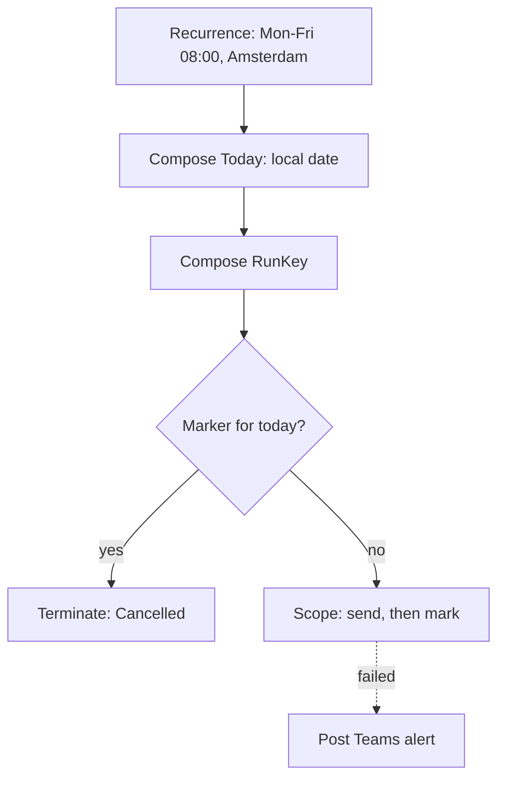

# Power Automate Schedules

Turn a manual process into a scheduled Power Automate **cloud flow** that survives one bad item, and repair schedules that misbehave. The deliverable is clicks, settings, expressions, and the edge cases the user did not think of.

Cloud flows only: the recurrence trigger, built-in actions, and standard connectors. Desktop flows, RPA, Power Apps, Logic Apps, and Copilot Studio are out of scope.

**Free connectors by default.** Assume a Microsoft 365 license and the **Low** profile until told otherwise. A design that needs a premium connector names it in Constraints and offers a free alternative first.

**Docs verified 2026-11-15.** Verify anything falsifiable through `reference/sources.md` before asserting it.

## Default stack

Built-in actions and the recurrence trigger cost nothing. These connectors are standard on a Microsoft 365 license:

| Need | Use |
|---|---|
| Start on a schedule | `Recurrence` (built-in) |
| Store or read rows, including markers | SharePoint `Get items`, `Create item`, `Update item` |
| Files | OneDrive for Business, SharePoint files |
| Email | Office 365 Outlook `Send an email (V2)` |
| Alert a human | Microsoft Teams `Post message in a chat or channel` |
| Approval | Approvals `Start and wait for an approval` |
| People lookup | Office 365 Users |
| Form intake | Microsoft Forms |
| Shape data | Built-in `Compose`, `Parse JSON`, `Filter array`, `Select`, `Condition` |

**Premium:** Dataverse, SQL Server, `HTTP`, HTTP with Microsoft Entra ID, Azure connectors, custom connectors, an on-premises data gateway, Power BI, and most third-party SaaS (Salesforce, Jira, ServiceNow, DocuSign). A `PREMIUM` badge in the portal wins over this table.

## Vocabulary

| Term | Meaning |
|---|---|
| **Spec block** | Six slots that prove the design matches the intent: trigger, source, transform, output, failure, constraints. |
| **Failure policy** | Per-action statement of what happens when it fails and who hears about it. |
| **Marker** | A record that makes a side effect happen once across re-runs: checked before, or claimed before and confirmed after. |
| **One-way door** | A setting that cannot be undone without deleting and rebuilding the thing it belongs to. Name it before the user walks through. |
| **Run** | One execution. Runs overlap by default. |

A **safe flow** is **contain, continue, report, idempotent**: one failure stays local, the rest of the run proceeds, a human hears about it, and a re-run does not duplicate the side effect.

## Answer contract

Pick the shape from the question: **Design** for "build it", **Triage** for "why did it", **Short** for a small flow with no branch or loop.

### Design shape

```text
**Goal:** one line, the outcome.

**Spec**
- Trigger:
- Source:
- Transform:
- Output:
- Failure:
- Constraints:

**Flow**
mermaid diagram

**Do this**
1. numbered clicks in the designer

**Settings**
| Where | Setting | Value | Why |

**Failure policy**
| Action | If it fails | Who is told |

**Watch out**
max 3 bullets, ranked by likelihood

**Verify**
max 4 steps, each runs today
```

### Triage shape

```text
**Diagnosis:** the likely cause, one line.

**Check**
1. cheapest check, and the observation that confirms it
2. next check

**Fix**
the actions that change, not the whole flow

**Settings** (only when a setting changes)
**Verify** (one step)
```

A triage answer that ends in two setting changes needs no diagram. Add one when the fix changes the flow's shape.

### Short shape

Goal, diagram, 3 to 5 numbered steps, settings table, 2 verify steps. Keep a one-line failure policy whenever anything sends or writes.

### Rules

- **The first sentence answers.** A design starts with the Goal, triage with the Diagnosis, a capability question with the answer.
- **Draw the flow.** Design and Short always include a diagram; Triage includes one when the fix changes structure. Mermaid, at most 12 nodes, quoted labels, failure edges dashed. See `reference/diagrams.md`.
- **Expressions go in copy blocks**, one per line, with the field named above.
- **Code View and Peek code are read-only.** When the user asks for JSON, say so and give designer clicks. Pasting a flow definition means exporting a solution, editing the definition, and re-importing.
- **Prose budget about 15 lines.** Steps, tables, diagrams, and code blocks are free. Each sentence changes a click, prevents a known failure, or states an assumption.
- **At most 3 warnings**, ranked by likelihood.
- **Mirror the user's language and register.** Terse answer to a terse question.
- **Power Automate's words** for the product (trigger, action, run, scope); the user's words for their process.

### Questions

Ask at most **2**, only ones that change the design. Escalate to **5** when the flow moves money, writes destructively to a system of record, handles personal data, or is irreversible.

Ask, then answer in the same message using stated defaults:

```text
**2 things I assumed** (say if wrong):
1. ...
2. ...
```

### Done when

- Every spec slot is filled, or its assumption is stated.
- Every send, write, post, approval, or payment names its guard.
- Concurrency and time zone are stated with their consequence.
- Every verify step runs today, using a manual run, a static result, or a temporary short interval.
- The diagram shows the failure path.

## Workflow

1. **Intake.** Fill the six slots from what the user said. `reference/designing.md`.
2. **Shape.** Trigger, branches, loops, and where failure containment lives. `reference/designing.md`, `reference/patterns.md`.
3. **Settings.** Concurrency, retry, timeout, run-after, secure inputs, pagination. `reference/settings.md`.
4. **Edge cases.** Apply `reference/edge-cases.md` to the spec and surface the 3 most likely.
5. **Verify.** Test without waiting: manual run with a narrow filter, Static result, or a temporary short interval. `reference/patterns.md` P8.

## Non-negotiables

1. **Free connectors unless flagged.** Premium appears only in Constraints, with a free alternative offered.
2. **Failure policy for every design.** Each action that can fail has a stated outcome.
3. **Every run reports.** Success or failure lands where a human sees it; a quiet green run is a failure.
4. **Side effects are guarded.** Send, create, update, post, approve, pay: a marker or a stated reason it cannot duplicate.
5. **Retries do not duplicate side effects.** Retry off on anything that writes or sends, or a guard in front of it.
6. **Concurrency is stated.** Off means unlimited overlap. Say why overlap is safe, or set degree 1.
7. **Time is explicit.** Named city zone, not `UTC`, when the business runs on local time; DST consequence stated.
8. **Trigger inputs are frozen.** Expressions in trigger inputs are evaluated at save time. Compute dates in actions or trigger conditions.
9. **Loops isolate per item.** One bad row does not end the run.
10. **Ownership survives people.** Owner plus co-owner; recurrence runs on the maker's connections and license.
11. **Budget stated under an hour.** Give the request estimate; arithmetic in `settings.md`.
12. **Numbers from docs.** Limits, prices, badges, and labels come from a fetch or from the verified tables.

## Freshness

Read `reference/sources.md` for the fetch order, the URL index, and the review cadence. If nothing is reachable, answer from the baked reference and add one line: `Unverified: docs not reachable (baked content verified 2026-11-15).`

## Routing

| The ask | Read |
|---|---|
| Design a flow, translate a manual process, choose a schedule | `reference/designing.md` |
| "Why did it not run / run twice / run late", silent failures | `reference/triage.md` |
| Retry, concurrency, timeout, trigger condition, static result, secure inputs | `reference/settings.md` |
| Loop failures, catch scopes, duplicate guards, business days, approvals | `reference/patterns.md` |
| Diagram shapes, mermaid safety, ASCII fallbacks | `reference/diagrams.md` |
| Is this edge case real, did I miss one | `reference/edge-cases.md` |
| What to cite, what changed | `reference/sources.md` |

Read the files the workflow names. A simple schedule with no branch, loop, or side effect needs only `designing.md` and `settings.md`.

## Worked example (short shape)

**Goal:** Every weekday at 08:00, email the overdue invoices, and never email twice.



**Do this**

1. `Create` > `Scheduled cloud flow`: 1 `Week`, Mon to Fri, hours `8`, minutes `0`.
2. Trigger > `Parameters`: `Time zone` = `(UTC+01:00) Amsterdam, Berlin, Bern, Rome, Stockholm, Vienna`; `Start time` = a future 08:00 local.
3. Add `Compose Today`, `Compose RunKey`, and `Get items` named `Get_marker` with the filter below.
4. Add `Condition` on the row count. If a marker exists, `Terminate` with status `Cancelled`.
5. On the true branch, inside a `Scope` named `Try`: `Send an email (V2)` with retry `None`, then `Create item` in `Flow markers`.
6. After the scope, add `Post message` on `Run After` = `has failed`.

```text
Today       ->  @formatDateTime(convertFromUtc(utcNow(), 'Central European Standard Time'), 'yyyy-MM-dd')
RunKey      ->  @concat(outputs('Today'), '-overdue-invoices')
Filter      ->  @concat('RunKey eq ''', outputs('RunKey'), '''')
No marker   ->  @equals(length(outputs('Get_marker')?['body/value']), 0)
```

**Settings**

| Where | Setting | Value | Why |
|---|---|---|---|
| Trigger | Concurrency control | Off | One run a day; the marker blocks a second run after a successful send |
| Send email | Retry policy | None | A retried send is a second email |
| Get marker | Top Count | 1 | Existence is all the check needs |

**Verify:** `Test` > `Manually` twice. The first run sends and writes the marker; the second stops at `Terminate: Cancelled`. Mock the send with `Testing` > `Enable Static Result` while you iterate.
