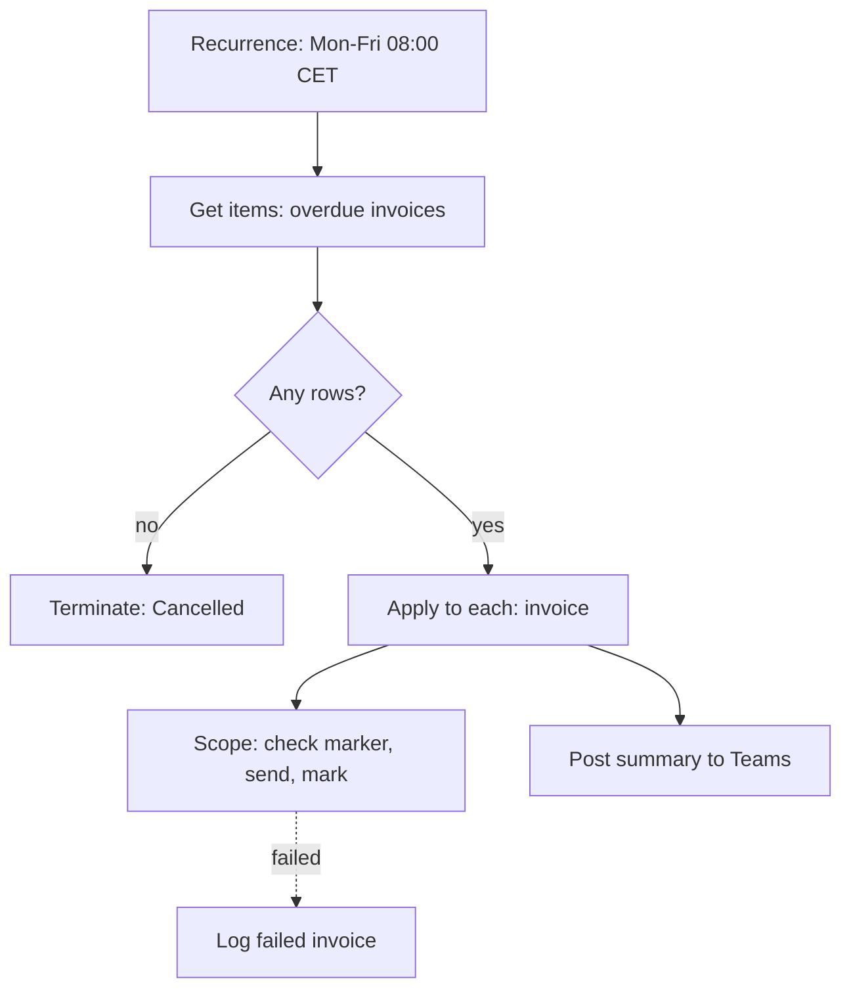
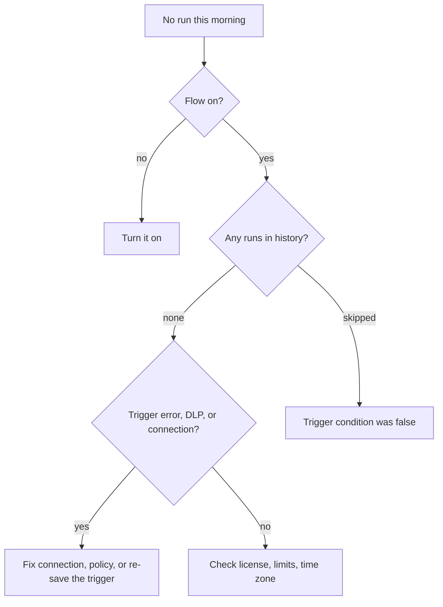
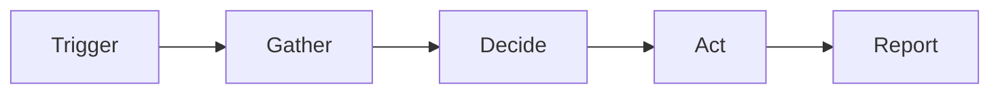

# Diagrams

A flow is a graph, so the diagram is the fastest way to check that the user and the skill mean the same thing. Draw one whenever the answer describes a flow: always for Design and Short, and for Triage only when the fix changes the shape. A settings-only fix, a capability question, or a refusal needs no picture.

## Mermaid rules

- `flowchart TD`, top to bottom.
- Quote every label: `A["Recurrence: Mon-Fri 08:00"]`. Inside a label, avoid parentheses, pipes, semicolons, and angle brackets
- Use `flowchart`; `subgraph` and `gantt` break more often than they help.
- Maximum 12 nodes. Above that, draw 3 to 5 phase boxes and let the steps carry the detail.
- Decision nodes use `{"..."}`.
- Failure and skip edges use a dashed arrow: `-.->|"failed"|`.
- Name the action, not the expression: `Compose RunKey`, never the formula.
- Unique node IDs. Reusing an ID silently merges nodes.
- `Terminate` nodes get their status in the label: `X["Terminate: Cancelled"]`.

## Template: design



## Template: triage



## Template: big flow, phase boxes



Then the numbered steps cover what sits inside each box.

## ASCII fallbacks

Use these when mermaid may not render, or when the point is timing rather than structure.

### Overlap

```text
08:00  [============ run A ============]
08:05      [============ run B ============]
           ^ concurrency off allows this
```

### DST

```text
Spring forward, 02:00 becomes 03:00
01:30        02:30              03:30
  |       X skipped               |

Fall back, 02:00 repeats
01:30   02:30   02:30   03:30
  |       run     run      |
```

### Marker check

```text
Compose key -> Get marker -> empty? --yes--> send -> create marker
                                  \--no--> stop
```

### Scope and catch

```text
[ Try: main work ] --failed/timed out--> [ Catch: compose + alert + terminate ]
```

### Per-item isolation

```text
Apply to each item
  [ Try item ] --failed--> [ Log item failure ]
        \-----------------------> next item
```

## Common breakages

| Symptom | Cause | Fix |
|---|---|---|
| Diagram shows as plain text | Fence is not `mermaid` | Use triple backticks with `mermaid` |
| Parse error on a label | Unquoted `:` `(` `,` or `/` | Wrap the whole label in double quotes |
| Text truncated | `<` or `>` in the label | Remove them or spell the words |
| Nodes merged | Duplicate IDs | Give each node a unique ID |
| Unreadable on one screen | More than 12 nodes | Switch to phase boxes |
| Arrows in the wrong order | Edges defined before nodes | Define nodes, then edges |
